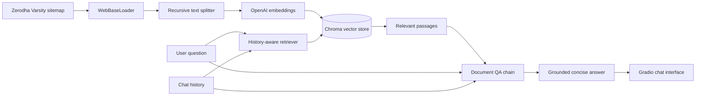

# Finance Pulse Q&A Agent with LangChain

> A history-aware financial education assistant that turns Zerodha Varsity content into concise, source-grounded answers using LangChain RAG.

## 1. Project Title & Value Proposition

**Finance Pulse Q&A Agent with LangChain** is a retrieval-augmented question-answering agent for learners and retail investors. It retrieves relevant material from Zerodha Varsity, follows the context of a conversation, and produces concise answers grounded only in the indexed content.

## 2. Background & Problem Context

Financial education libraries contain valuable information, but finding a precise answer often requires searching across many chapters and translating unfamiliar terminology. This is especially time-consuming for beginners who may not know which topic or chapter contains the answer.

Keyword search and a basic chatbot are limited: search returns documents rather than a direct response, while an ungrounded chatbot can produce plausible but unsupported financial claims. This project combines semantic retrieval with strict answer constraints so users can ask natural-language questions and receive focused, context-aware explanations.

## 3. Target User & Job To Be Done (JTBD)

- **Primary user:** Students, beginner investors, and self-directed learners studying financial markets.
- **Secondary users:** Educators or mentors who need a quick way to locate concepts in the indexed learning material.
- **JTBD:** Find a concise, contextually relevant answer to a finance question without manually searching through numerous chapters, while keeping the response grounded in the available educational content.

## 4. Why an Agentic Approach

A fixed script cannot reliably map the many ways users phrase a question to the most relevant source passages. A simple chatbot also lacks a dependable knowledge boundary. This agent dynamically:

1. Interprets follow-up questions using chat history.
2. Rewrites a dependent question as a standalone retrieval query when needed.
3. Selects relevant passages through semantic search.
4. Generates an answer under explicit grounding and length constraints.
5. Falls back when the indexed documents do not contain the requested information.

The current version uses a constrained agentic RAG workflow rather than an open-ended autonomous agent: it reasons over conversational context and retrieval, but it does not execute financial transactions or modify external systems.

## 5. Agent Role, Scope & Autonomy Level

The agent owns the question-answering flow from query interpretation through retrieval and response generation.

**In scope**

- Answering educational finance questions from indexed Zerodha Varsity content.
- Resolving conversational references in follow-up questions.
- Returning concise answers of no more than three sentences.
- Declining to answer when supporting context is unavailable.

**Out of scope**

- Personalized financial, investment, tax, or legal advice.
- Trading, portfolio management, or transaction execution.
- Claims based on sources outside the indexed content.

The user retains control through the **Delete Previous** and **Clear** interface actions. No human approval step is currently required because the agent performs read-only question answering.

## 6. Agent Architecture & Components



### Planner / Decision Layer

LangChain's history-aware retriever uses the conversation and latest message to decide whether the question must be reformulated as a standalone query. Planning is narrow and dynamic: it determines the retrieval query rather than constructing a multi-step action plan.

### Executors

- `WebBaseLoader` loads finance education pages discovered through the sitemap.
- `RecursiveCharacterTextSplitter` creates overlapping retrieval chunks.
- `OpenAIEmbeddings` converts chunks into vector representations.
- `Chroma` stores vectors and retrieves semantically similar passages.
- `ChatOpenAI` reformulates context-dependent questions and generates answers.
- Gradio provides the chat interface and conversation controls.

### Memory

- **Short-term:** Gradio chat history is converted into LangChain `HumanMessage` and `AIMessage` objects for each request.
- **Long-term knowledge:** Chroma holds embeddings for the loaded and chunked web content during the application session.

### Orchestration Logic

`create_history_aware_retriever` and `create_retrieval_chain` coordinate query reformulation, retrieval, context injection, and response generation. The present implementation does not include explicit retries, persistent conversation memory, or automated retrieval-quality validation.

## 7. End-to-End Agent Workflow

1. Fetch the Zerodha Varsity sitemap and extract chapter URLs.
2. Load the first 114 pages with `WebBaseLoader`.
3. Split pages into 1,000-character chunks with 200-character overlap.
4. Generate OpenAI embeddings and index the chunks in Chroma.
5. Accept a question and the current Gradio chat history.
6. Reformulate the latest message when it depends on earlier turns.
7. Retrieve semantically relevant chunks from Chroma.
8. Ask the language model to answer using only the retrieved context.
9. Return a maximum-three-sentence response or the configured fallback message.

## 8. Tools, Models & Stack

| Component | Technology | Rationale |
|---|---|---|
| Orchestration | LangChain | Provides composable history-aware retrieval and document QA chains. |
| Language model | `gpt-4o-mini` | Supports low-temperature, concise query reformulation and answer generation at relatively low latency and cost. |
| Embeddings | OpenAI Embeddings | Creates semantic representations for similarity-based retrieval. |
| Vector store | Chroma | Offers a simple local vector index suitable for prototyping RAG applications. |
| Content source | Zerodha Varsity | Supplies structured educational material about markets and investing. |
| Web ingestion | Beautiful Soup + `WebBaseLoader` | Extracts sitemap URLs and converts individual pages into LangChain documents. |
| Interface | Gradio | Enables a lightweight conversational UI with examples and history controls. |
| Environment | Google Colab + `python-dotenv` | Supports notebook-based execution and secret loading during development. |

## 9. Evaluation Strategy & Metrics

The repository currently does not include an automated evaluation suite. A production-oriented evaluation should measure:

- **Grounded-answer accuracy:** Percentage of answers fully supported by retrieved passages.
- **Retrieval relevance:** Recall@k or human-rated relevance of the returned chunks.
- **Fallback precision:** How often the agent correctly declines questions not covered by the corpus.
- **Conversational consistency:** Success rate on follow-up questions containing pronouns or omitted context.
- **Latency:** End-to-end response time, separated into retrieval and generation time.
- **Cost:** Embedding cost during indexing and model cost per question.
- **User correction rate:** Percentage of answers users must rephrase, reject, or correct.

A practical test set should include direct questions, paraphrases, multi-turn follow-ups, ambiguous prompts, out-of-scope requests, and adversarial attempts to bypass the grounding instruction.

## 10. Guardrails, Trust & Safety

- The system prompt requires answers to use only retrieved context.
- Responses are limited to three sentences to reduce unsupported elaboration.
- When the answer is absent, the agent is instructed to return: `I cannot find that information in the available documents.`
- Unclear questions should trigger a follow-up request rather than a guess.
- The application is read-only and cannot place trades or change financial accounts.
- Users can delete the previous turn or clear the conversation.

This project is an educational prototype and should not be treated as personalized financial advice. For stronger auditability, a future version should expose citations, retrieval scores, request traces, and model usage logs.

## 11. Failure Modes & Tradeoffs

- **Source freshness:** Answers reflect the content indexed when the app starts; changed web pages are not synchronized during a session.
- **Coverage limits:** Only the first 114 sitemap URLs are loaded, so relevant material may be omitted.
- **Retrieval errors:** Semantic similarity can return incomplete or adjacent passages, producing a weak answer even when the source contains the information.
- **No visible citations:** The current UI returns an answer without showing the supporting chapter URLs.
- **Instruction adherence:** Prompt-based grounding reduces hallucination risk but does not mathematically guarantee it.
- **Startup cost:** The app downloads, splits, embeds, and indexes the corpus on every run.
- **Ephemeral state:** The vector store and chat context are not configured for durable persistence.
- **Availability:** Web ingestion depends on the source site and network access.

Larger chunks may preserve context but reduce retrieval precision; smaller chunks improve targeting but may separate important explanations. Increasing the number of retrieved passages can improve recall while adding latency, cost, and irrelevant context.

## 12. Results, Learnings & Insights

The current prototype demonstrates a complete conversational RAG path: web ingestion, chunking, embedding, semantic retrieval, history-aware question reformulation, constrained generation, and a usable chat interface.

The most important design learning is that conversational retrieval needs two forms of context: chat history to understand the question and source passages to support the answer. The current implementation also makes the next engineering priorities clear—persistent indexing, citations, automated evaluation, and operational error handling.

Quantitative accuracy, latency, and cost results have not yet been published. Add benchmark results here after running the evaluation plan above.

## 13. Future Improvements & Iteration Plan

- Persist the Chroma collection so the corpus is not re-embedded on every launch.
- Store source metadata and display citations with each answer.
- Add configurable retrieval parameters and reranking.
- Build an automated groundedness and retrieval evaluation suite.
- Add timeouts, retries, rate-limit handling, and structured logging.
- Crawl all intended chapters with deduplication and incremental refresh.
- Move secrets and environment handling into a portable configuration layer.
- Add input moderation and explicit financial-advice disclaimers in the UI.
- Package the application for reproducible local or cloud deployment.

## 14. Demo & Artifacts

The application launches a Gradio interface and can optionally create a temporary public share link using `share=True`.

### Example questions

- What is an index fund?
- Where can I buy stocks?
- How does that differ from an ETF?

Add a stable hosted demo, walkthrough video, sample traces, and screenshots when available.

## Role-Based Signal

- **For Product Managers:** Demonstrates problem framing, user scope, knowledge boundaries, success metrics, safety constraints, and explicit product tradeoffs.
- **For Engineering Managers:** Demonstrates modular RAG architecture, orchestration, component boundaries, scaling risks, and an iteration plan.
- **For Software Engineers:** Demonstrates web ingestion, semantic indexing, history-aware retrieval, prompt-constrained generation, message conversion, and Gradio integration.

## Getting Started

### Prerequisites

- Python 3.10 or later
- An OpenAI API key
- A Google Colab environment for the code as currently written

### Install dependencies

```bash
pip install beautifulsoup4 lxml python-dotenv gradio chromadb \
  langchain-openai langchain-community langchain-text-splitters langchain-chroma
```

### Configure the API key

The current implementation reads `OPENAI_API_KEY` from Google Colab secrets:

```python
from google.colab import userdata
os.environ["OPENAI_API_KEY"] = userdata.get("OPENAI_API_KEY")
```

Add a Colab secret named `OPENAI_API_KEY` before running the notebook. For local execution, replace the Colab-specific secret lookup with environment-based configuration:

```python
load_dotenv()
# OPENAI_API_KEY should be defined in your environment or .env file.
```

Do not commit API keys or `.env` files.

### Run the application

Execute the code in Google Colab. The program will load and index the content before launching the Gradio interface. Initial startup time and OpenAI usage depend on the number and size of the pages embedded.

## Disclaimer

This project is for educational and demonstration purposes only. It does not provide personalized investment, tax, legal, or financial advice.
